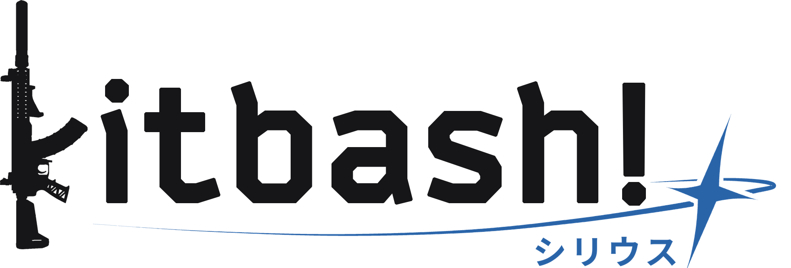

<p align="center">
  <picture>
    <source media="(prefers-color-scheme: dark)" srcset="media-kit/kitbash_wordmark_sirius_light_ink_600.png">
    
  </picture>
</p>

<p align="center"><a href="README.md">English</a> · <a href="README_ZH.md">中文</a></p>

# Kitbash! Sirius for EFT version 1.3.0.1.48558

Kitbash! Sirius draws Escape from Tarkov weapon builds as 2D images, framed like the
game's own item icons. Kitbash! Sirius is the public version of the rendering engine behind
[EFTForge](https://github.com/SouthHorizons76/EFTForge)'s build previews (which runs Kitbash! Arcadia instead).

Each part is rendered once, offline, into a sprite with a depth map. A build is then
put together by stacking those sprites at 2D offsets with a depth test. This works
because the game's icon camera is orthographic where a part looks the same wherever it
sits, and its position on screen follows directly from its 3D mount point. Rendering
a build takes milliseconds and needs no game, without needing a GPU and/or browser.

**This public build contains no game assets.** It has the compositor code only. You bake the
sprites yourself from your own copy of the game, and you're responsible for how you
use them.

## License and credit

MIT terms, plus one condition: any app, site or service that uses Kitbash! or shows
images made with it must say somewhere users can find it (an about, credits or legal
page is fine) that its images are generated by Kitbash!, with a link to this
repository. Forks shared with others must not be called Kitbash!. The full
terms are in [LICENSE](LICENSE). Logos for the credit are in [media-kit/](media-kit/).

## Requirements

- Escape from Tarkov installed, on the live client (the baker reads its asset
  bundles). [data/tables-version.txt](data/tables-version.txt) names the client the
  shipped item tables were made for.
- Unity **2022.3.62f3** on Windows, for the bake only
- Python 3.10+ with Pillow 11+ (`pip install -r requirements.txt`)

Rendering needs only Python and Pillow. Unity and the game are needed only to bake.

## Layout

```
baker/      Unity project. Bakes the sprites. Bake time only.
kitbash/    The compositor. Python, import it in-process.
scripts/    Data extraction and bake tooling.
spec/       manifest.md: the contract between the baker and the compositor.
data/       Item base and tables (shipped), plus what the bake generates (not committed).
sprites/    Baked sprites (not committed).
```

## First bake

The item tables the bake needs (`data/slots.json`, `bundles.json`, `sizes.json`,
`sights.json` and `ammo.json`: ids, slot names, bundle paths and sizes, no assets)
ship with the repository, for the client version in `data/tables-version.txt`, along
with the item base they're built from (`data/items-base.json`).

1. **Point the baker at the game.** Set `KITBASH_GAME_ROOT` to the folder that holds
   `EscapeFromTarkov.exe` (it defaults to `C:\Battlestate Games\Escape from Tarkov`).
   Restart Unity Hub as well as the editor after setting it, or Unity keeps the old
   environment.

2. **Open `baker/` in Unity** and run `Kitbash! / Inspect All`. It writes
   `data/inspect.json` (which model each part uses), `data/bones-all.json` and
   `data/icon-poses.json`.

3. **Bake:**

   ```
   python scripts/bake.py            # works out every sprite orientation
   Unity: Kitbash! / Bake Sprites (all)
   python scripts/bake.py --pack     # converts PNG to WebP and summarises the bake
   ```

   A full bake is about 11,700 sprites. The result is `sprites/` plus
   `data/sprites.manifest.json`.

## Rendering

```python
from kitbash import Compositor, KitbashError, UnsupportedWeapon

kb = Compositor()  # reads data/sprites.manifest.json and sprites/
image = kb.render(items, scale=2)  # a PIL image, straight alpha
image.save("build.webp")
```

`items` is a build in the game's internal item format: `items[0]` is the weapon (or a helmet), and
every other entry has `_id`, `_tpl`, `parentId` and `slotId`, with an optional `upd`
for folded stocks (`Foldable.Folded`) and toggles (`Togglable.On`).

- `UnsupportedWeapon` means the weapon itself has no sprite, so nothing can be drawn.
- `KitbashError` means a part can't be drawn. Pass a list to `kb.layers(items, skipped)`
  to have such parts left out and reported instead.
- `kb.load_ammo(items, ammo_tpl)` fills the build's magazines with rounds, as the
  game shows a loaded weapon.

The output size defaults to the build's inventory cells times 63, plus 1, times `scale`.

### Helmets

A helmet can be the root too, drawn with its attachments at the game's icon pose.
Face shields and NVG mounts are baked in both positions, and `Togglable.On` picks
which one is drawn: a part without it is drawn up (off), as a new item is in game.
To show them down, set it on every attachment:

```python
items = [items[0]] + [{**it, "upd": {**(it.get("upd") or {}), "Togglable": {"On": True}}} for it in items[1:]]
```

## Updating for a game patch

When a patch adds items, this repository (hopefully) gets updated tables and a new
`data/tables-version.txt`. Pull them, update your game, and bake what's new. New items
only need their own sprites, and existing sprites keep their indices:

```
git pull
Unity: Kitbash! / Inspect All
python scripts/orientations.py --new          # only what the manifest has no sprite for
Unity: Kitbash! / Bake Sprites (subset)
python scripts/bake.py --pack
```

To redo specific weapons, use `python scripts/bake.py --only <weapon template id>...`
and `Bake Sprites (subset)`. Rebake everything with `(all)` only after a change that
affects every model, such as a new Unity version or GPU driver on the bake machine.

If your client is newer than the shipped tables, items added since then are left out
of renders until the tables catch up. Items the patch renamed or removed may fail to
bake; the bake report lists them.

### Updating the tables yourself (optional)

You only need this to get ahead of the shipped tables. [Atlas](https://www.eftforge.com/atlas)
tracks every change to the game's item data as a change set. `scripts/update_items.py`
replays the sets newer than the item base onto it, and `scripts/extract_data.py`
rebuilds the tables from the result and your game install:

```
python scripts/update_items.py      # writes data/items.json
python scripts/extract_data.py      # rewrites the tables and data/tables-version.txt
```

Then bake what's new, as above. The next `update_items.py` run continues from your
`data/items.json`.

Atlas opens each change set to the public a few hours after the patch. `update_items.py`
stops at the first set that isn't open yet and says when it opens. If you have an Atlas
key, pass it with `--key` (or set `ATLAS_KEY`) to read those sets right away.

Your rebuilt tables replace the shipped ones in your copy, and `extract_data.py`
stamps your client's version into the README headings, so run
`git restore data README.md README_ZH.md` before your next `git pull`.

## Notes

- Every bake that draws at least one sprite stamps the manifest's `gameVersion` with
  the version of the client it baked from.
- The bake scale is `KitbashConfig.Supersample` (2x). Raise it for larger output.
- Don't commit `sprites/` or the files the bake writes to `data/`, or open pull
  requests containing them: they're derived from game files. `.gitignore` keeps them
  out; only the item base and tables are tracked.

Escape from Tarkov is a trademark of Battlestate Games. Kitbash! is a fan project, not
affiliated with or endorsed by Battlestate Games.
