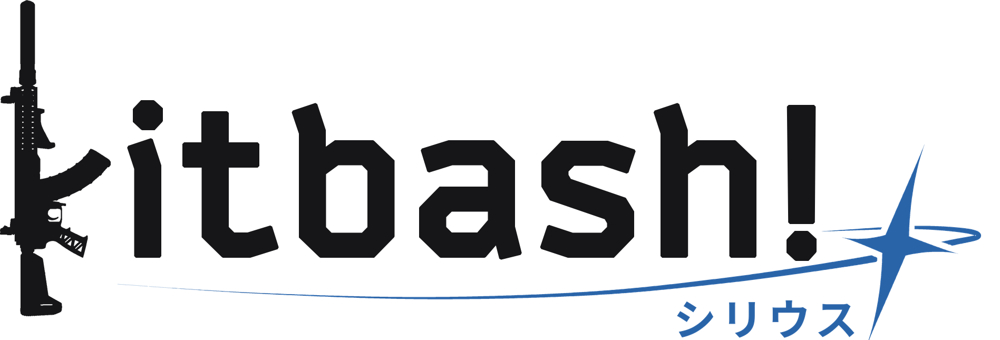

<p align="center">
  <picture>
    <source media="(prefers-color-scheme: dark)" srcset="media-kit/kitbash_wordmark_sirius_light_ink_600.png">
    
  </picture>
</p>

<p align="center"><a href="README.md">English</a> · <a href="README_ZH.md">中文</a></p>

# Kitbash! Sirius 适配 EFT 版本 1.3.0.1.48558

Kitbash! Sirius 将逃离塔科夫的武器配置绘制为 2D 图像，构图与游戏自身的物品图标一致。Kitbash! Sirius 是 [EFTForge](https://github.com/SouthHorizons76/EFTForge) 配置预览背后渲染引擎的公开版本（EFTForge 本身使用的是 Kitbash! Arcadia）。

每个配件都会离线渲染一次，生成带深度图的精灵图。之后组装配置时，只需按 2D 偏移叠放这些精灵图并进行深度测试。之所以可行，是因为游戏的图标相机是正交投影：配件无论放在哪里外观都相同，而它在屏幕上的位置直接由其 3D 安装点决定。渲染一个配置只需几毫秒，既不需要游戏，也不需要 GPU 或浏览器。

**此公开版本不包含任何游戏资源。** 仓库中只有合成器代码。精灵图需要你用自己的游戏文件自行烘焙，如何使用它们由你自行负责。

## 许可与署名

采用 MIT 条款，外加一个条件：任何使用 Kitbash! 或展示其生成图像的应用、网站或服务，都必须在用户能找到的地方（关于、致谢或法律页面均可）注明其图像由 Kitbash! 生成，并附上本仓库的链接。分享给他人的分支不得命名为 Kitbash!。完整条款见 [LICENSE](LICENSE)。用于署名的标志位于 [media-kit/](media-kit/)。

## 环境要求

- 已安装逃离塔科夫正式服客户端（烘焙器会读取其资源包）。[data/tables-version.txt](data/tables-version.txt) 注明了随仓库提供的物品表对应的客户端版本。
- Windows 上的 Unity **2022.3.62f3**，仅烘焙时需要
- Python 3.10+ 与 Pillow 11+（`pip install -r requirements.txt`）

渲染只需要 Python 和 Pillow。Unity 和游戏仅在烘焙时需要。

## 目录结构

```
baker/      Unity 项目，用于烘焙精灵图，仅烘焙时使用。
kitbash/    合成器，Python，在进程内导入使用。
scripts/    数据提取与烘焙工具。
spec/       manifest.md：烘焙器与合成器之间的约定。
            character.md：角色头像与全身图的生成方式。
data/       物品数据底本与物品表（随仓库提供），以及烘焙生成的文件（不提交）。
sprites/    烘焙出的精灵图（不提交）。
```

## 首次烘焙

烘焙所需的物品表（`data/slots.json`、`bundles.json`、`sizes.json`、`sights.json` 和 `ammo.json`：只有 ID、槽位名、资源包路径和尺寸，不含任何资源）随仓库提供，对应 `data/tables-version.txt` 中的客户端版本，同时附带生成它们所用的物品数据底本（`data/items-base.json`，其中也包含角色烘焙所需的外观模板）。

1. **让烘焙器找到游戏。** 将 `KITBASH_GAME_ROOT` 设为 `EscapeFromTarkov.exe` 所在的文件夹（默认为 `C:\Battlestate Games\Escape from Tarkov`）。设置后需要同时重启 Unity Hub 和编辑器，否则 Unity 会沿用旧的环境变量。

2. **在 Unity 中打开 `baker/`**，运行 `Kitbash! / Inspect All`。它会写出 `data/inspect.json`（每个配件使用哪个模型）、`data/bones-all.json` 和 `data/icon-poses.json`。

3. **烘焙：**

   ```
   python scripts/bake.py            # 计算每张精灵图的朝向
   Unity: Kitbash! / Bake Sprites (all)
   python scripts/bake.py --pack     # 将 PNG 转为 WebP，并汇总烘焙结果
   ```

   完整烘焙约有 11,700 张精灵图，结果为 `sprites/` 和 `data/sprites.manifest.json`。

## 渲染

```python
from kitbash import Compositor, KitbashError, UnsupportedWeapon

kb = Compositor()  # reads data/sprites.manifest.json and sprites/
image = kb.render(items, scale=2)  # a PIL image, straight alpha
image.save("build.webp")
```

`items` 是游戏内部物品格式的配置：`items[0]` 是武器（或头盔），其余每一项都包含 `_id`、`_tpl`、`parentId` 和 `slotId`，并可带有可选的 `upd`，用于折叠枪托（`Foldable.Folded`）和开关状态（`Togglable.On`）。

- `UnsupportedWeapon` 表示武器本身没有精灵图，无法绘制。
- `KitbashError` 表示某个配件无法绘制。向 `kb.layers(items, skipped)` 传入一个列表，即可跳过这些配件并在列表中报告。
- `kb.load_ammo(items, ammo_tpl)` 会按游戏显示已装填武器的方式，为配置中的弹匣装满子弹。

输出尺寸默认为配置所占的物品栏格数乘以 63，加 1，再乘以 `scale`。

### 头盔

头盔也可以作为根物品，以游戏的图标姿态连同其配件一起绘制。面罩和夜视仪支架在两种位置下都会烘焙，由 `Togglable.On` 决定绘制哪一种：没有该字段的配件按抬起（关闭）状态绘制，与游戏中新物品的状态一致。要显示放下状态，请为每个配件设置该字段：

```python
items = [items[0]] + [{**it, "upd": {**(it.get("upd") or {}), "Togglable": {"On": True}}} for it in items[1:]]
```

## 角色

Kitbash! 还可以根据玩家档案绘制角色：商人界面显示的**头像**（500 x 500，与游戏自身一致），以及一张**全身图**（788 x 1238）。做法与武器相同：每个头部、上身服装、裤子和穿戴装备都会烘焙一次，涵盖整套装扮可能需要的每种变体（穿在护甲下、兜帽戴上或放下、被面罩裁切等），之后按深度叠放这些精灵图组成角色。各部件如何选择见 [spec/character.md](spec/character.md)。

### 烘焙

角色烘焙只需要物品数据底本和 `data/slots.json`，不需要运行 `Inspect All`。按上文设置好游戏路径后，在 Unity 中：

```
Unity: Kitbash! / Bake Character Headshots (all)
python -m kitbash.character pack headshot      # PNG 转为无损 WebP
Unity: Kitbash! / Bake Character Full Body (all)
python -m kitbash.character pack full
```

每种视图约 2,900 张精灵图（打包后约 200 MB），写出 `sprites/character/<视图>/`，以及 `data/character.manifest.json`（头像）或 `data/character-full.manifest.json`（全身）。只烘焙你需要的视图即可。每次烘焙都会替换该视图的全部精灵图，因此在加入新服装或装备的版本更新后，需要整体重新烘焙。`(test kit)` 菜单项只烘焙一套装扮，便于检查环境配置；`Kitbash! / Character Test Render` 会直接在 Unity 中渲染一个穿戴好的角色，作为与合成结果对照的参考（`data/render/character/`）。

### 渲染

```python
from kitbash.character import CharacterCompositor

cc = CharacterCompositor("headshot")  # or "full"
image = cc.render(
    {"head": head_id, "body": body_id, "feet": feet_id},  # customization template ids
    equipment,  # the profile's inventory items
)
image.save("headshot.webp")
```

`equipment` 是游戏内部格式的物品列表（`_id`、`_tpl`、`slotId`、`parentId`，可选 `upd`）。穿戴物品是位于 `ArmorVest`、`TacticalVest`、`Backpack`、`Headwear`、`Earpiece`、`Eyewear`、`FaceCover` 和 `ArmBand` 槽位中的物品，它们的子项即为其配件，其余物品会被忽略。面罩和夜视仪与头盔图标一样遵循 `Togglable.On`。携带的武器暂不绘制，头像始终使用持枪姿势。每次合成约 0.2 秒。

## 游戏更新

当版本更新加入新物品时，本仓库会提供更新后的物品表和新的 `data/tables-version.txt`。拉取更新、更新游戏，然后烘焙新增内容即可。新物品只需要烘焙它们自己的精灵图，已有精灵图的索引保持不变：

```
git pull
Unity: Kitbash! / Inspect All
python scripts/orientations.py --new          # 只包含清单中还没有精灵图的部分
Unity: Kitbash! / Bake Sprites (subset)
python scripts/bake.py --pack
```

如需重新烘焙特定武器，使用 `python scripts/bake.py --only <武器模板 ID>...` 和 `Bake Sprites (subset)`。只有在影响所有模型的变更之后（例如烘焙机器更换了 Unity 版本或显卡驱动），才需要用 `(all)` 全部重新烘焙。

如果你的客户端比随仓库提供的物品表更新，那么此后新增的物品在物品表跟上之前不会出现在渲染中。被更新改名或移除的物品可能会烘焙失败，烘焙报告会列出它们。

### 自行更新物品表（可选）

只有在想抢先于随仓库提供的物品表时才需要这样做。[Atlas](https://www.eftforge.com/atlas) 以变更集的形式记录游戏物品数据的每一次变化。`scripts/update_items.py` 会把比物品数据底本更新的变更集依次应用上去，`scripts/extract_data.py` 再根据结果和你的游戏安装重新生成物品表：

```
python scripts/update_items.py      # 写出 data/items.json
python scripts/extract_data.py      # 重写物品表和 data/tables-version.txt
```

然后按上文烘焙新增内容。下次运行 `update_items.py` 时会从你的 `data/items.json` 继续。它也会一并更新外观模板。如果你的 `data/items.json` 写于角色烘焙加入之前，只要它与随仓库提供的底本处于同一个 Atlas 变更集，下次运行时就会从底本补上缺少的字段；否则它会提示你从随仓库提供的底本重新开始。

Atlas 会在版本更新数小时后向公众开放每个变更集。`update_items.py` 会在第一个尚未开放的变更集处停下，并告诉你它何时开放。如果你有 Atlas 密钥，可以用 `--key` 传入（或设置 `ATLAS_KEY`），即可立即读取这些变更集。

重新生成的物品表会替换你本地副本中随仓库提供的版本，`extract_data.py` 也会把你的客户端版本写入 README 的标题，因此在下次 `git pull` 之前请先运行 `git restore data README.md README_ZH.md`。

## 说明

- 每次至少绘制了一张精灵图的烘焙，都会把清单中的 `gameVersion` 标记为烘焙所用客户端的版本。
- 烘焙倍率为 `KitbashConfig.Supersample`（2x），需要更大的输出时可以调高。
- 不要提交 `sprites/` 或烘焙写入 `data/` 的文件，也不要发起包含它们的拉取请求：它们来源于游戏文件。`.gitignore` 已将它们排除，仓库只跟踪物品数据底本和物品表。

Escape from Tarkov（逃离塔科夫）是 Battlestate Games 的商标。Kitbash! 是第三方自制项目，与 Battlestate Games 无关，也未获其认可。
